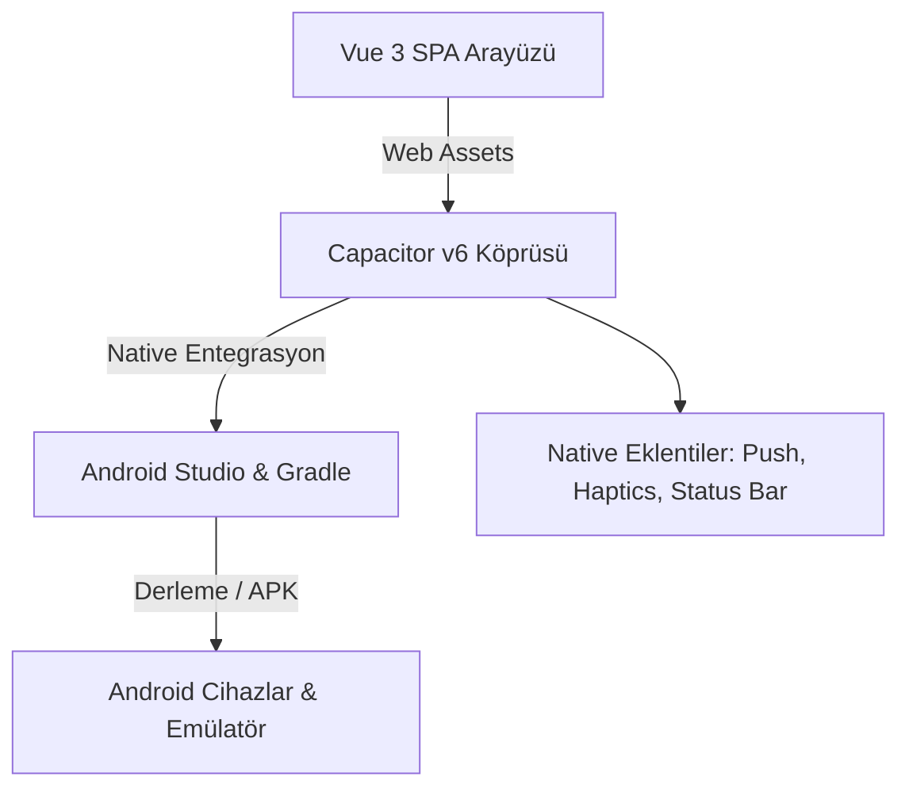

# Leafy Mobile 🎙️💬

> **Modern Hibrit Sesli Sohbet ve Mesajlaşma Uygulaması Prototipi**  
> *Capacitor v6 · Vue 3 SPA · Android (Java & Gradle) · Tailwind CSS*

---

## 🎓 Proje Hakkında & Akademik Bağlam

Bu proje, **İstanbul Beykent Üniversitesi Bilgisayar Programcılığı (Önlisans)** son sınıf öğrencisi olarak, modern mobil ve hibrit web mimarilerini, gerçek zamanlı iletişim arayüzlerini ve platformlar arası uygulama geliştirme pratiklerini deneyimlemek amacıyla hazırlanmış bir **eğitim ve portföy prototipidir**.

### 🤖 Vibe Coding & Yapay Zeka Beyanı
> **Not:** Bu prototip, güncel yazılım geliştirme pratikleri doğrultusunda **Yapay Zeka destekli "Vibe Coding" metodolojisi** ve prompt mühendisliği yaklaşımları kullanılarak kurgulanmış, optimize edilmiş ve eğitici bir vaka çalışması olarak derlenmiştir.

---

## 📱 Özellikler

- **Modern Arayüz**: Discord ve benzeri modern platformlardan ilham alan koyu temalı, odaklı ve minimalist kullanıcı deneyimi.
- **Ses Odaları (Voice Rooms)**: Gerçek zamanlı sesli iletişim ekranları ve katılımcı durumu göstergeleri.
- **Kanal ve DM Sohbeti**: Metin kanalları, birebir mesajlaşma ve zengin reaksiyon/çıkartma rozetleri.
- **Android Uyumluluğu**: Capacitor v6 köprüsü ile Android WebView üzerinde yerel performans ve native API erişimi (Push bildirimleri, durum çubuğu kontrolü, dokunsal geri bildirim).
- **Optimize Boyut**: Gereksiz derleme artıklarından arındırılmış, hafifletilmiş depo yapısı.

---

## 🏗️ Mimari Yapı



---

## 📦 Hazır Yüklenebilir APK

Projeyi fiziksel bir Android telefonda doğrudan test etmek için derlenmiş hazır hata ayıklama paketi mevcuttur:

📂 **`release/leafy-debug-v1.0.apk`** *(~9.9 MB)*

---

## 🚀 Kurulum ve Çalıştırma

### Gereksinimler
- **Node.js** 20+
- **Android Studio** (Hedgehog veya üzeri)
- **JDK** 17

### Adımlar

1. **Bağımlılıkları Yükleyin:**
   ```bash
   npm install
   ```

2. **Android Dosyalarını Senkronize Edin:**
   ```bash
   npm run sync:android
   ```

3. **Android Studio'da Açın:**
   ```bash
   # Windows için tek tıkla:
   open-android.bat

   # veya komut satırından:
   npm run open:android
   ```

---

## 📂 Dizin Yapısı

```
mobile/
├── android/            # Yerel Android Studio projesi (Java, Gradle, XML)
│   └── app/src/main/   # Android kaynak kodları ve WebView varlıkları
├── assets/             # Uygulama ikon ve görsel kaynakları
├── release/            # Doğrudan yüklenebilir APK dağıtım paketi
├── open-android.bat    # Windows için hızlı başlatıcı
├── capacitor.config.json # Capacitor platform ayarları
├── package.json        # Bağımlılıklar ve derleme scriptleri
└── README.md
```

---

## 📄 Lisans

Bu proje [MIT Lisansı](LICENSE) kapsamında açık kaynak olarak lisanslanmıştır.
